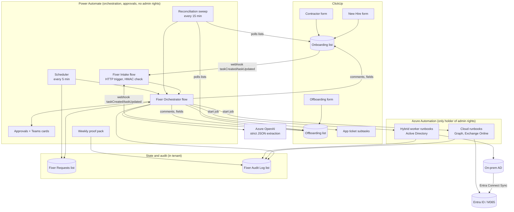

# Fixer: Onboarding and Offboarding Workflow Design
**Surf Crew / Fixer** | Draft v0.1 | October 13, 2026 | Owner of this doc: Dave Christy
**Status:** design draft. Items marked **[ASSUMPTION]** or listed in section 14 need your answer before build.

**Confidence key.** **[V]** checked this session against official vendor documentation (one source each, which is below your three-source bar; see Sources). **[U]** my working knowledge, not verified; each has a "how to verify" note. **[OBS]** observed directly in your ClickUp workspace today.

---

## 0. Top-line view (read this first)

1. **Your intake is three forms, not two.** [OBS] The "📋 New Hire IT Onboarding Form" list receives two different forms: the New Hire form and a separate "New Contractor IT Onboarding Form" (17 contractor submissions so far). Offboarding has one form, named "Employee IT Offboarding Form", and contractors go through it too (for example, "Lori Tichenor Contractor Termination", and Chandra Vijay, who was onboarded as a contractor). So: onboarding employee vs. contractor is readable from which form was used; **offboarding employee vs. contractor is not on the form at all** and must be looked up.
2. **Neither form captures what the workflow needs to be safe.** No contractor end date, no worker type on offboarding, no urgency or confidentiality flag, no fields for Databricks, Claude, ChatGPT, or Copilot, and no HR confirmation. Form changes are a prerequisite (section 4.3), not a nice-to-have.
3. **Recommended platform split.** Power Automate is the orchestrator and approval engine. Azure Automation runbooks are the only component holding admin rights: cloud runbooks for Entra ID, groups, licenses, and Exchange Online; a **Hybrid Runbook Worker** on a domain-joined server for Active Directory. Fixer's reasoning (classification and free-text parsing) uses the Azure OpenAI pattern your email triage flow already runs. ClickUp SuperAgent, Zapier, and n8n do not hold credentials in this design. You told me nothing on-prem can run automation today, so **standing up the hybrid worker is the critical-path prerequisite.**
4. **One approval per change set, two stages for offboarding.** HR confirms the person and the dates; IT approves the exact change set. Offboarding splits into a fast "containment" approval (block cloud sign-in, revoke sessions, disable AD) and a full deprovisioning approval, so a slow approver can never leave access open past the termination time.
5. **Offboarding timing is a scheduler problem, not a flow-delay problem.** Power Automate runs time out at 30 days [V], so future-dated terminations are held in a state table and fired by a recurring scheduler with a late-fire alarm. Today, at least one offboarding task ([Chandra Vijay](https://app.clickup.com/t/868met07j)) is still "to do" four days past its revocation time [OBS]; the access may well have been removed, but nothing in ClickUp proves it. That is exactly the gap this design closes.
6. **Build order:** prerequisites, then shadow mode on both forms (Fixer prepares everything and alerts on missed offboardings, humans still execute), then employee onboarding execution, then offboarding execution, then contractor end-date enforcement.

---

## 1. Scope and how this extends Fixer's charter

Fixer's current charter (Session 1) is Entra ID and M365 tasks plus Intune actions, with every change approved during the pilot. This workflow **extends Fixer into on-premises Active Directory and full identity lifecycle**. That is a bigger blast radius than password resets and app installs: a wrong offboarding disables the wrong person. Two consequences:

- Fixer's charter document needs this added explicitly, with the owner's sign-off.
- Sentinel's rule from Session 1 applies: offboardings and terminations are sensitive (time-critical, often confidential). In this design Sentinel's role is a check, not a gate that can delay a termination: it flags a target account that is privileged (admin roles, finance groups, service accounts) for extra review, but never blocks containment.

**In scope:** the three intake forms; AD; Entra ID; M365 groups (including distribution lists); M365 license assignment; ClickUp (originating task, workspace membership, app tickets); one ClickUp app ticket per business app for Databricks, BlueCherry, NuOrder, YPLM, Qlik, Claude, ChatGPT, Copilot; Exchange Online and OneDrive items that the offboarding form already asks for (forwarding, delegate access, auto-reply, file transfer).

**Out of scope for v1 (stay as today's manual subtasks):** hardware, shipping, and equipment retrieval; Adobe, Zoom, Dropbox, FileCloud, AccuMark, GitHub. Fixer creates the human tasks for these but does not act on them.

---

## 2. Architecture

**Design rules (carried from Session 1):**
- The reasoning layer decides; it never holds credentials. Only Azure Automation holds admin rights, through managed identities, and only for a short list of named runbooks.
- Every runbook is idempotent: it checks current state before acting and reports "already done" as success.
- Every step writes an audit row before and after it runs.

---

## 3. Trigger: capturing the submissions

### 3.1 Recommendation: ClickUp API webhook into one Power Automate entry point

- Register **one ClickUp webhook** (API) scoped to the two lists (or two webhooks, one per list) for `taskCreated` and `taskUpdated`, pointing at a Power Automate flow with the "When an HTTP request is received" trigger.
- The flow verifies the **`X-Signature` header**, an HMAC-SHA256 of the raw body using the webhook secret, hex encoded [V]. Reject anything that fails.
- **One workflow, shared downstream logic.** The webhook payload carries the task ID; Fixer immediately calls the ClickUp API to get the full task. The **list ID** says onboarding (`901100618258`) or offboarding (`901100622311`) [OBS]. Two entry points would duplicate validation, idempotency, and logging for no gain.
- **Reconciliation sweep (required, not optional).** A scheduled flow every 15 minutes lists tasks created or updated in both lists in the last 24 hours and processes any without a Fixer Request ID. This covers missed or failed webhook deliveries. ClickUp's webhook signature page does not document retry or delivery guarantees; it links a separate "webhook health" page I did not verify [U]. **Verify:** read ClickUp's webhook health documentation and test by disabling the flow for 10 minutes, submitting a test form, and confirming the sweep catches it.
- **Race guard:** wait 60 seconds after `taskCreated` before reading the task, then read it once more if any required field is empty, in case form fields land after creation [U]. **Verify:** submit test forms and compare the webhook timestamp to the field values returned.

### 3.2 Why not the alternatives

| Option | Verdict | Reason |
|---|---|---|
| Native ClickUp Automation ("when task created, call webhook") | Fallback only | Fewer controls than an API webhook: I have not verified it signs requests, and it depends on your plan [U]. **Verify:** check whether your plan's Automations include a webhook action and whether it sends a signature. |
| ClickUp SuperAgent as the Fixer | Not for decisions or execution | Session 1 found no documented approval step before tool actions, and data shared with a Super Agent can surface to anyone who can trigger it [V, Session 1]. A termination is confidential. It could later post friendly status summaries, nothing more. |
| Zapier | No | Per-task cost, weaker audit, and a third party holding a path to your admin runbooks. |
| n8n | No for v1 | Ownership moved to Mike's team in the transition; adding a privileged workload there splits ownership. Revisit if n8n becomes the team standard. |

### 3.3 How form of origin and worker type are read

| Signal | Onboarding | Offboarding |
|---|---|---|
| Onboarding vs. offboarding | List ID of the task | List ID of the task |
| Employee vs. contractor | Contractor form populates **New Contractor(s) Name(s)** and **Country Office Located In**; New Hire form populates **Employee Title**, **Supervisor's Email**, **Location** [OBS]. Fixer classifies on that deterministic rule, not on the LLM. | Not on the form. Resolution order: (1) the new **Worker Type** field (section 4.3); (2) Fixer Requests history for that person; (3) AD `employeeType` attribute, which Fixer stamps at onboarding; (4) AD OU (if contractors live in their own OU) **[ASSUMPTION]**; (5) if still unknown, treat as **contractor** (the stricter path) and ask the HR approver to confirm in the approval card. |

---

## 4. Forms: what exists, what's missing, and how fields map

### 4.1 Onboarding fields observed [OBS]

Fields below exist as ClickUp custom fields on the onboarding list. None are marked required at the list level; the forms themselves may enforce required answers [U]. **Verify:** open each form in ClickUp and note which questions are required.

| Form field (ClickUp custom field) | Used by Fixer for | Target system |
|---|---|---|
| Task name (holds the person's name; "New Hire Name" is usually empty) | givenName, surname, displayName; UPN and sAMAccountName generation | AD |
| New Contractor(s) Name(s) | Worker type = contractor; name. **Plural field:** one submission can name several people. Fixer splits it into one request per person. | AD |
| Employee Title | `title` | AD (syncs to Entra) |
| Supervisor's Name / Supervisor's Email | Resolve to manager's AD object; `manager` attribute; approval routing; credential delivery | AD |
| Requestor's Name / Email (contractor form; stored in the task description only, not a custom field) | Requester identity, separation of duties check | Fixer state |
| Start Date and Time | When to enable the account; when app tickets are due | Scheduler |
| Location / Office Locations / Country Office Located In | `physicalDeliveryOfficeName`, OU (if OU is by site **[ASSUMPTION]**), `usageLocation` (required for licensing) | AD, Entra |
| Division(s) Access | Mapped to groups through a Division-to-Group table you maintain | AD or Entra groups |
| CFT / PDC / Costing TP Distro Groups (free text) | LLM normalizes to known distribution list names; anything unmatched is flagged, never guessed | M365 groups |
| "All employees automatically receive..." (apps multi-select) | BlueCherry Infinity creates the BlueCherry app ticket; VPN and file shares map to AD groups; ClickUp triggers ClickUp workspace invite; Adobe, Zoom, Dropbox, FileCloud, AccuMark create today's manual subtasks | AD, ClickUp |
| NuOrder Access Needed, Portal(s) | NuOrder app ticket with portals listed | ClickUp ticket |
| Qlik Access Needed | Qlik app ticket | ClickUp ticket |
| YPLM Access Needed, Primary YPLM Role, YPLM comments, Print Library | YPLM app ticket with role | ClickUp ticket |
| New Headcount? | License source: reuse a freed license or check purchase availability | M365 license |
| Replacing Existing User? | Confirm that user is offboarded or scheduled; reuse their license | Fixer state |
| Existing Employee to Copy | Read that person's groups as a **suggested** template, shown as a diff in the approval card; sensitive groups excluded | Fixer prep only |
| Primary Language | `preferredLanguage` | Entra |
| Hardware, Additional Equipment, shipping fields | Equipment task for IT (human) | ClickUp |
| Any Additional Information | LLM extracts implied app needs (for example, "Databricks Engineer who will need access to GitHub & Databricks" on [Vivek Singh](https://app.clickup.com/t/868mfbnvj)) as **suggestions** for the approver, never as automatic grants | Fixer prep only |

### 4.2 Offboarding fields observed [OBS]

| Form field | Used by Fixer for | Target system |
|---|---|---|
| Task name / Employee Name | Display only. **Never used as the identifier.** | n/a |
| Employee Company Email | **Primary key.** Resolved to exactly one AD user and one Entra user (objectGUID and Entra object ID). Zero or multiple matches stop the request. | AD, Entra |
| Date & Time of Termination (EST) | `executeAt` for containment. Stored as a timestamp with offset, so daylight time is handled; the "EST" label is misleading and should read "Eastern". | Scheduler |
| Supervisor Name / Company Email | Notifications; default delegate | Exchange, OneDrive |
| Automatic (Out of Office) Reply Message | Mailbox auto-reply | Exchange Online |
| Forward Email To | Mailbox forwarding (Sentinel checks it's internal) | Exchange Online |
| Grant Mailbox Access To | Delegate full access | Exchange Online |
| Transfer Files To | OneDrive access for the named person | OneDrive / SharePoint |
| Employee Location, Mailing Address for Equipment Retrieval | Equipment retrieval task (existing statuses and email reminders continue) | ClickUp |
| Specific Instructions | LLM extracts handling notes (for example, "Dave will handle removing GitHub and Databricks access" on [Chandra Vijay](https://app.clickup.com/t/868met07j) reassigns that app ticket to Dave) | ClickUp tickets |

### 4.3 Required form changes (prerequisite)

| Form | Add field | Why |
|---|---|---|
| Contractor onboarding | **Contract End Date** (required) | Cannot enforce an end date that is never captured |
| Contractor onboarding | **Sponsor** (Swim USA employee accountable; required) and **Contracting company** | Approval routing and extension owner |
| Contractor onboarding | One person per submission, or a repeatable block | The plural name field makes idempotency and approvals per person messy |
| Both onboarding forms | Checkboxes for **Databricks, Claude, ChatGPT, Copilot**, and a standalone **BlueCherry** checkbox | These apps are in scope but have no field today |
| Both onboarding forms | **Personal email or phone** for credential delivery **[ASSUMPTION: or deliver to supervisor]** | Today there is no way to get first credentials to the person |
| Offboarding | **Worker Type** (Employee / Contractor) | Routing |
| Offboarding | **Urgency**: Scheduled / Immediate | Fast-track path |
| Offboarding | **Confidential** (involuntary or sensitive) | Suppresses app tickets and broad notifications until the termination time |
| Offboarding | **Mailbox and data retention**: keep as shared mailbox / no retention needed | License removal deletes the mailbox after a grace period [U]; see 6.3 |
| Offboarding | Rename "Date & Time of Termination (EST)" to "Access cutoff date and time (Eastern)" | Removes ambiguity between last working day and access cutoff |
| Offboarding list and onboarding list | Fixer custom fields: **Fixer Request ID**, **Fixer State**, **Worker Type (resolved)**, **Approval Status**, **Scheduled Execution**, **Fixer Summary** | Status loop (section 9) |

**Existing ClickBot automations must be turned off or Fixer will duplicate them.** [OBS] Native ClickUp automations already create app subtasks (for example "YPLM User Needed" and "New ClickUp User Needed"). Fixer replaces those for the eight in-scope apps.

---

## 5. Active Directory and Entra ID: how they interact here

You told me you run **Entra Connect Sync**. What follows is how Connect Sync behaves by default; several points depend on your configuration and are flagged with how to check.

| Topic | What I know | Depends on your config | How to verify |
|---|---|---|---|
| Where synced users are created | Synced users are created in AD; Connect Sync provisions them to Entra. Attributes mastered in AD (name, title, manager, UPN) must be changed in AD. | Which OUs are in sync scope | On the Connect server: Synchronization Service Manager, or `Get-ADSyncConnector` and review OU filtering. |
| Sync delay | Default cycle is every 30 minutes [V]. A delta sync can be started on the Connect server with `Start-ADSyncSyncCycle -PolicyType Delta`. | Whether you changed the scheduler | `Get-ADSyncScheduler` on the Connect server (shows interval and next run). |
| Disabled accounts | Disabled AD accounts still sync to Entra [V]; the disabled state flows to Entra at the next cycle. So **an AD-only disable can leave cloud sign-in working for up to one cycle**, and existing tokens keep working until they expire. | Authentication method (password hash sync, pass-through auth, or federation) changes how fast an AD disable blocks new cloud sign-ins | `Get-MgDomain` (authenticationType) and the Connect wizard's "View current configuration". |
| Disabling the cloud side directly | Microsoft's hybrid revocation guidance says: disable in AD, reset the password twice, **and** disable in Entra and revoke sessions [V]. Revoking sessions can take a few minutes to apply [V]. | Whether a cloud-side disable on a synced user persists or is overwritten by the next sync while AD is still enabled | **Test:** on a test synced user, set Entra `accountEnabled=false` only, wait for one sync, check it. Fixer disables AD in the same run, so either way the final state is disabled. |
| Groups | AD security groups and AD distribution groups sync to Entra and must be changed in AD. Cloud groups (Microsoft 365 groups, Teams, cloud security groups) are changed in Entra. Dynamic groups can't take direct membership. | Which of your groups are AD-sourced | `Get-MgGroup -All -Property displayName,onPremisesSyncEnabled,groupTypes,mailEnabled` (Graph PowerShell). Fixer keeps a Group Registry table with source = AD or Cloud per group. |
| Licenses | License assignment is cloud-only. A license needs `usageLocation` set on the user. Group-based licensing turns licensing into a group membership change. | Whether you license directly or by group, and whether license groups are AD or cloud groups | Entra admin center, Licenses, Licensed groups; `Get-MgSubscribedSku` for available counts. |
| `usageLocation` on synced users | I believe it can be set in the cloud on synced users unless you sync it from AD [U]. | Your sync rules | Set it on a test synced user via Graph and confirm it persists after a sync. |
| `employeeType` | Entra has an `employeeType` property [U on whether your Connect version syncs it by default]. | Sync rules | Check the attribute on a synced user after setting it in AD. |
| AD account expiration (`accountExpires`) | Enforced by AD. I'm not certain it blocks cloud sign-in under password hash sync [U]. Treat it as a backstop only, never as the contractor control. | Auth method | Test on a contractor test account with an expiry in the past. |
| Exchange | If mailboxes once lived on an on-prem Exchange server, some mail attributes may still be managed from on-prem tools. | Whether you have (or had) Exchange hybrid | Check for an Exchange server or the Exchange Management Tools in AD; ask Netrio. |

**Built-in alternative worth knowing (not recommended for v1):** Entra **API-driven inbound provisioning** can create, enable, and disable users in on-prem AD through a lightweight provisioning agent, with no inbound ports; it is available with Entra ID P1 [V], and **Lifecycle Workflows** can disable synced AD users with the same agent but need Entra ID Governance licenses [V]. Neither handles AD group membership changes or approvals by themselves, so they don't remove the need for a runbook host. Worth a second look if you later buy ID Governance.

---

## 6. Routing: the four paths

### 6.1 Access matrix by path

**[ASSUMPTION]** These defaults are my proposal; contractor and AI-tool policy is yours and the AI Council's to set.

| Item | Employee onboard | Contractor onboard | Employee offboard | Contractor offboard |
|---|---|---|---|---|
| AD account | Create in Employees OU | Create in Contractors OU, `employeeType=Contractor`, `accountExpires` = end date + 1 day | Disable, reset password, move to Disabled OU | Same |
| Entra | Wait for sync, set `usageLocation`, `preferredLanguage` | Same | Block sign-in, revoke sessions | Same |
| M365 groups | From division mapping, distro fields, copy-from suggestion (approved) | Explicit list only; copy-from **not** allowed by default (prevents copying an employee's broad access) | Remove from all AD and cloud groups (after mailbox steps) | Same |
| M365 license | Standard employee SKU **[ASSUMPTION: you'll name it]** | Contractor SKU or none **[ASSUMPTION]** | Remove after mailbox conversion | Remove (no mailbox retention by default) |
| ClickUp (workspace) | Invite if "ClickUp" selected | Invite as guest **[ASSUMPTION]** | Remove member | Remove guest |
| Databricks | Ticket if requested | Ticket if requested (sponsor justification required) | Revoke ticket | Revoke ticket |
| BlueCherry | Ticket if requested | Ticket if requested, IT approver extra check | Revoke ticket | Revoke ticket |
| NuOrder | Ticket if requested | Ticket if requested | Revoke ticket | Revoke ticket |
| YPLM | Ticket if requested (role required) | Ticket if requested | Revoke ticket | Revoke ticket |
| Qlik | Ticket if requested | Ticket if requested | Revoke ticket | Revoke ticket |
| Claude | Ticket if requested | Not allowed by default **[ASSUMPTION: AI Council decides]** | Revoke ticket | Revoke ticket |
| ChatGPT | Ticket if requested | Not allowed by default **[ASSUMPTION]** | Revoke ticket | Revoke ticket |
| Copilot | Ticket if requested | Not allowed by default **[ASSUMPTION]** | Revoke ticket | Revoke ticket |
| Approvers | HR + IT | Sponsor + IT (HR only if HR owns contractor records; see 14) | HR + IT | Sponsor (or HR) + IT |
| Timing | Execute 3 business days before start, enable on start morning **[ASSUMPTION]** | Same, plus end-date schedule | At cutoff time | At cutoff time or contract end, whichever first |

**Offboarding creates revoke tickets for all eight apps, every time,** not only the ones requested at onboarding. Access gets granted outside the form (Chandra Vijay had Databricks and GitHub via Dave directly [OBS]). An app owner closes a ticket as "No account found" in seconds; a skipped ticket is a silent exposure. Any still-open onboarding tickets for the person are cancelled.

**Copilot note:** Microsoft 365 Copilot is a license, and Claude and ChatGPT may already be single sign-on apps assigned through Entra groups [U]. If so, those three could later become group or license changes Fixer executes after approval, instead of tickets. **Verify:** Entra admin center, Enterprise applications, check for Claude and ChatGPT apps and how users are assigned.

### 6.2 Onboarding: steps in order (employee path; contractor differences noted)

**Legend:** **PREP** = automated preparation, runs without approval. **CHANGE** = account change, runs only after approval.

| # | Step | Type | System | Input | Output |
|---|---|---|---|---|---|
| 1 | Receive webhook or sweep hit, verify signature, read full task | PREP | ClickUp, PA | Webhook JSON `{event, task_id, history_items}` | Task JSON with custom fields |
| 2 | Compute idempotency key; check Fixer Requests (section 8.1) | PREP | Fixer state | Task JSON | New request, or link to existing and stop |
| 3 | Classify worker type (deterministic rule, 3.3); split multi-name contractor submissions | PREP | PA | Task JSON | One normalized request per person |
| 4 | Validate required fields (section 8.4) | PREP | PA | Normalized request | Pass, or "Needs Info" comment to requester |
| 5 | Extract from free text (distro fields, Additional Information, copy-from names) | PREP | Azure OpenAI, strict JSON schema | Text fields | `{distroGroups[], suggestedApps[], copyFromUsers[], anomalies[]}` with confidence; unmatched items flagged |
| 6 | Resolve people: manager, requester, copy-from users, replaced user | PREP | Graph read, AD read via hybrid worker read-only runbook | Emails and names | Object IDs; zero or multiple matches flagged |
| 7 | Detect existing identity (rehire or duplicate): search AD and Entra by name, personal email, and prior Fixer records | PREP | AD, Entra, Fixer state | Name and identifiers | "New", "Possible rehire: reactivate?" or "Duplicate: link to request X" |
| 8 | Generate UPN and sAMAccountName per your naming standard **[ASSUMPTION: first.last]**; check collisions in AD and Entra (including mail and proxyAddresses) | PREP | AD, Entra read | Name | Unique UPN, sAM, mail |
| 9 | Build group set: division table, normalized distro lists, apps that map to AD groups, copy-from diff (employees only), minus Sentinel's sensitive-group list | PREP | Group Registry | Steps 3 to 6 | List of `{group, source: AD or Cloud, reason}` |
| 10 | License check: SKU per worker type; available count | PREP | Graph `subscribedSkus` | Worker type, New Headcount? | SKU and "available" or "purchase needed" (blocks approval until resolved) |
| 11 | Create app tickets (subtasks) for requested in-scope apps in status **"Held: awaiting approval"**, plus human tasks for equipment and out-of-scope apps | PREP | ClickUp | App selections | Ticket IDs stored on the request |
| 12 | Build the change set and its hash; write Fixer fields and a summary comment on the task | PREP | Fixer state, ClickUp | Steps 7 to 11 | Change set JSON (section 7.3) |
| 13 | Request approvals: HR (or sponsor) confirms person and dates, then IT approves the change set | PREP | PA Approvals, Teams | Change set | Approval records |
| 14 | On approval: schedule execution at max(now, start minus 3 business days) | PREP | Fixer state | Approved change set | Scheduled job |
| 15 | Create AD user, disabled, in the right OU, with attributes, manager, `employeeType`; contractor: `accountExpires` | **CHANGE** | AD (hybrid worker) | Change set | objectGUID |
| 16 | Add AD group memberships | **CHANGE** | AD | AD groups | Results per group |
| 17 | Start delta sync, then poll Graph every 5 minutes up to 90 minutes for the new user | PREP | Connect server, Graph | UPN | Entra object ID, or "sync timeout" alert |
| 18 | Set `usageLocation`, `preferredLanguage`; add cloud group memberships; assign license (direct or license group) | **CHANGE** | Entra, M365 | Change set | Results |
| 19 | Invite to ClickUp workspace if selected (if the API supports it on your plan [U]; otherwise a human subtask) | **CHANGE** | ClickUp | Email | Member ID |
| 20 | Release app tickets: status "Ready", due on start date, assigned to app owners | PREP | ClickUp | Ticket IDs | Tickets in owners' queues |
| 21 | On start morning: enable AD account; issue first credential per your policy (for example, a Temporary Access Pass to the supervisor) **[ASSUMPTION; see 14]** | **CHANGE** | AD, Entra | Change set | Enabled account |
| 22 | Verify end state (account enabled in Entra, license active, groups present), post completion comment, set Fixer State "Complete" | PREP | Graph, ClickUp | Request | Verification record |

**Contractor differences:** step 9 uses the explicit list only; step 10 uses the contractor SKU; step 15 sets `accountExpires`; step 14 also writes the end-date schedule (section 8.3).

### 6.3 Offboarding: steps in order (both paths)

| # | Step | Type | System | Input | Output |
|---|---|---|---|---|---|
| 1 | Receive, verify, read task | PREP | ClickUp, PA | Webhook | Task JSON |
| 2 | Resolve **Employee Company Email** to exactly one AD and one Entra user | PREP | AD, Entra read | Email | Object IDs, or stop with "Needs Info" |
| 3 | Idempotency check (target object ID plus "offboard") | PREP | Fixer state | Object IDs | New, update of existing, or duplicate |
| 4 | Resolve worker type (3.3); validate cutoff time, urgency, confidential, retention | PREP | PA | Task JSON | Normalized request |
| 5 | Sentinel check: privileged roles, admin or finance groups, shared or service account | PREP | Graph read | Object ID | Risk flags shown to approvers |
| 6 | Inventory current access: AD groups, cloud groups, licenses, mailbox type, devices, open Fixer app tickets | PREP | AD, Entra, Exchange (read) | Object IDs | Access snapshot (kept for audit and rollback) |
| 7 | Extract handling notes from Specific Instructions | PREP | Azure OpenAI | Text | Ticket reassignments, flagged anomalies |
| 8 | Create revoke tickets for all eight apps in status "Held"; if Confidential, create them in a restricted list or only at cutoff | PREP | ClickUp | App list | Ticket IDs |
| 9 | Build two change sets: **Containment** (steps 12 to 14) and **Deprovision** (steps 15 to 19); request approvals (7.5) | PREP | PA Approvals | Snapshot | Approval records |
| 10 | Schedule containment at cutoff; Immediate = now | PREP | Fixer state | Cutoff | Scheduled job |
| 11 | At T minus 24 hours (scheduled path): if approvals are not complete, escalate (7.4) | PREP | PA | Request | Escalation |
| 12 | Block Entra sign-in (`accountEnabled=false`) and revoke sessions | **CHANGE** | Entra | Object ID | Done, with timestamp |
| 13 | Disable AD account, reset password twice to random values [V], stamp description with request ID, move to Disabled OU | **CHANGE** | AD | objectGUID | Done |
| 14 | Remove ClickUp workspace membership (if API supported [U]; else urgent human subtask) | **CHANGE** | ClickUp | Member ID | Done |
| 15 | Mailbox: set auto-reply, forwarding (internal only), delegate access; convert to shared mailbox if retaining | **CHANGE** | Exchange Online | Change set | Done |
| 16 | OneDrive: grant access to "Transfer Files To" person | **CHANGE** | SharePoint / OneDrive | Change set | Done |
| 17 | Remove from all AD groups and cloud groups (keep a license group only until 18) | **CHANGE** | AD, Entra | Snapshot | Done |
| 18 | Remove licenses, **only after** step 15 confirms the shared mailbox conversion (removing a license from a user mailbox starts deletion of the mailbox after a grace period [U]) | **CHANGE** | M365 | Change set | Done |
| 19 | Release revoke tickets (due within 4 business hours **[ASSUMPTION]**); cancel open onboarding tickets | PREP | ClickUp | Ticket IDs | Tickets in owners' queues |
| 20 | Verify after next sync: Entra disabled, no sessions, no licenses, no group memberships; post completion | PREP | Graph | Request | Verification record |
| 21 | Account deletion at T plus 30 days **[ASSUMPTION: your retention rule]**, as a **separate approval** because it is irreversible | **CHANGE** | AD | objectGUID | Deleted (AD Recycle Bin should be on) |

**Verify:** the mailbox grace period and shared mailbox behavior in Microsoft's Exchange Online documentation before building step 18.

---

## 7. Approvals

### 7.1 Who approves

| Path | Stage 1: confirm the person and dates | Stage 2: approve the change set |
|---|---|---|
| Employee onboarding | HR role **[NEED NAME]** | IT approver **[NEED ROLE + backup chain]** |
| Contractor onboarding | Sponsor named on the form (HR as well if HR keeps contractor records **[NEED ANSWER]**) | IT approver |
| Employee offboarding | HR role | Containment: any member of an IT on-call approver group, first responder wins. Deprovision: IT approver |
| Contractor offboarding | Sponsor or HR | Same as employee |

**Separation of duties:** the requester can never approve their own request. Example from the data: Dave submitted the [Vivek Singh](https://app.clickup.com/t/868mfbnvj) contractor onboarding himself [OBS]; Fixer would route the IT approval to the next person in the chain. The person being offboarded can never be an approver either.

### 7.2 Where approvals happen and how they're recorded

- **Mechanism:** Power Automate Approvals ("Start and wait for an approval" or "Create an approval" plus "Wait for an approval"), delivered as Teams adaptive cards and email. Custom responses: **Approve**, **Request changes**, **Reject**.
- **Recorded in three places:** (1) the Power Automate approval record (who, when, response, comments) [U on retention details]; (2) a row in the Fixer Audit Log with approver UPN, timestamp, response, comment, and the **change set hash**; (3) a ClickUp comment on the originating task: "Approved by Jane Doe (IT Director) at 10:42 AM ET, change set a1b2c3."
- **Verify:** where your tenant stores approval history (the Approvals feature uses Dataverse in the default environment [U]) and how long it is retained. Fixer's own audit log is the record of truth either way.

### 7.3 What the approver sees (example card)

> **Onboard: Carissa Hardas (Employee) starting Mon, Oct 19, 9:00 AM ET**
> Requested by Stephanie Cohen. HR confirmed Oct 14, 3:10 PM.
> **Will create:** AD account carissa.hardas (Employees OU, title Senior Designer, manager Stephanie Cohen), disabled until Oct 19, 8:00 AM.
> **Will add to 6 groups:** LB, PB, MS division groups; Target CFT and Target PDC distribution lists; File share group for Design.
> **Will assign license:** Microsoft 365 E3 (2 available).
> **App tickets (held until you approve):** YPLM (Design Team role).
> **Not included, needs your call:** "Existing Employee to Copy" listed two people; 3 groups they have are not on this list (shown below). Tap to add any.
> **Flags:** Replacing Jessica D'Alessio; her license will be reused after her offboarding completes.
> [Approve] [Request changes] [Reject]

Rules for the card: plain language, every change listed (no "and 4 more"), dates in Eastern time, flags at the bottom, and the change set hash in the footer.

### 7.4 Rejection, changes requested, and timeouts

| Event | Onboarding | Offboarding |
|---|---|---|
| Reject | Fixer State "Rejected"; held app tickets cancelled; comment to requester with the reason; no changes made | Same, plus a notice to HR, since a rejected termination is unusual and needs a human conversation |
| Request changes | Fixer State "Needs Info"; comment to requester with the approver's note; requester edits the task fields; edit re-triggers validation and a fresh approval (new hash) | Same |
| No response | Reminder at 24 hours; escalate to backup at 48 hours; at 5 business days mark "Stalled" and alert the Fixer owner. If start date is within 2 business days, escalation compresses to 4 and 8 hours. | Scheduled: reminder at 24h, escalate at T minus 24h, page the on-call approver group at T minus 4h. Immediate: see 7.6. |
| Flow run limit | Approval waits are set well under the 30-day flow run limit [V]; each wait has an explicit timeout and a timeout branch | Same |

### 7.5 One approval or many? Recommendation

**One approval per change set, not per change.** Approvers will rubber-stamp ten separate prompts; one complete, readable card gets real attention. The card lists every item, and **Request changes** handles "approve everything except X." The approval is bound to the change set **hash**: if anything in the change set changes after approval (edited form, new group, different date), the approval is void and a new one is requested.

**Exception, offboarding gets two approvals:** Containment (block sign-in, revoke sessions, disable AD, remove ClickUp) and Deprovision (mailbox, files, groups, licenses). Containment is small, standard, and needs speed; deprovisioning has data-retention consequences and can wait hours. Account deletion is a third, separate approval at T plus 30 days.

### 7.6 Making approval latency safe for offboarding

- **Scheduled terminations:** approvals are requested at submission, often days ahead, so they're complete before the cutoff. The T minus 24h and T minus 4h escalations exist so that an unapproved containment is a page, not a surprise.
- **Immediate terminations:** containment approval goes to the IT on-call approver group in Teams with a 15-minute escalation, then 30 minutes to the backup chain and a phone call **[ASSUMPTION: who carries the phone]**. Containment is the only step on the clock; it is one card, three lines.
- **Cutoff passes without approval:** Fixer does **not** act (your rule holds), but it fires a P1 alert to the Fixer owner and IT approvers every 15 minutes, and the task shows "Cutoff passed: containment not approved" in red. Exposure is visible and owned, never silent.
- **Pre-approval option for you to decide:** HR and the IT approver can approve containment at submission time for a scheduled termination, so it fires at T with no one awake. That is still prior human approval. I recommend it.

---

## 8. Edge cases

### 8.1 Duplicates and idempotency

- **Request key (person level):**
  - Onboarding: `ONB|{workerType}|{normalized full name}|{start date}|{supervisor or sponsor email}`, plus a directory check for an existing account.
  - Offboarding: `OFF|{Entra object ID}`. Only one active offboarding per person.
- **Step key:** `{request key}|{step name}`. Before each CHANGE step Fixer checks the step key in the audit log; "succeeded" means skip. Runbooks also check live state (for example, `Get-ADUser` before `New-ADUser`), so a retry after a timeout can't create a second account.
- **Where state lives:** a SharePoint list **Fixer Requests** (one row per request: key, ClickUp task IDs, state, change set JSON, hash, approvals, schedule) and **Fixer Audit Log** (append-only, one row per event). This matches the SharePoint audit list your email triage flow already uses. The ClickUp task also carries the Fixer Request ID so humans can see the link. **Upgrade path:** Dataverse, if you need transactional locking at higher volume.
- **Concurrency:** Fixer takes a lease on the request row (a "locked until" timestamp) before acting, so a webhook and the sweep can't process the same request at the same time.
- **Resubmitted form** (new ClickUp task, same person): linked to the existing request; the new task gets a comment "Duplicate of IT-40213, no action taken" and is closed. If the details differ, it's treated as an edit of the original (below).
- **Edited form** (`taskUpdated`): before approval, re-validate and rebuild the change set; after approval but before execution, void the approval and request a new one; after execution, Fixer posts the difference and opens a change request for IT, never re-runs.
- **Rehires:** the name-and-date key will not match a previous year's request, so step 7 searches the directory. A disabled account for the same person becomes "Possible rehire: reactivate account?" for the approver, rather than a second account.
- **Evidence this matters:** there are repeated names in the onboarding list (for example, two Kelsey Casilla tasks, two Rachael Leone tasks, two Kristi Bartholomew tasks) [OBS]. Some may be rehires or corrections, but each is exactly the case this key handles.

### 8.2 Offboarding timing and security

- **Holding future-dated offboardings:** not with "Delay until" in a long-running flow (30-day limit [V]). The approved containment sits in Fixer Requests with `executeAt`. A **scheduler flow runs every 5 minutes** and fires any row where `executeAt <= now` and state is "Approved: Scheduled".
- **Late-fire alarm:** any approved containment not completed within 15 minutes of `executeAt` is a P1 alert to the Fixer owner and the IT on-call group.
- **Scheduler health:** the scheduler writes a heartbeat row on every run; the token-health flow pattern you already run can check that heartbeat hourly and alert if it's stale.
- **Fast-track:** Urgency = Immediate skips the queue, sends the containment card at once (7.6), and executes the moment it's approved.
- **Cutoff moved earlier:** containment reschedules to the new time with no new approval (the action is the same, only sooner). **Moved later:** requires re-approval, because access stays open longer.
- **Confidential terminations:** app tickets, ClickUp comments, and Teams notifications avoid naming the reason; tickets are created at the cutoff, not at submission; the approval card goes only to the named approvers.

### 8.3 Contractor end dates

- **Capture:** Contract End Date is required on the contractor form (4.3). Fixer rejects an end date more than 12 months out **[ASSUMPTION]**.
- **Enforcement:** at onboarding, Fixer writes a **scheduled offboarding** to Fixer Requests for the end date and sets AD `accountExpires` as a backstop. At end minus 10 business days, Fixer comments to the sponsor and creates the offboarding request so approvals happen before the date. At end minus 2 business days, it escalates if neither an extension nor approval exists.
- **Missing end date** (including today's 17 contractors with none [OBS]): onboarding stays in "Needs Info". For existing contractors, a one-time backfill: Fixer lists active contractor accounts and asks each sponsor for an end date.
- **Extended:** sponsor submits an extension (a short "Contractor Extension" form **[ASSUMPTION]**, or edits the date on the original task); Fixer requests sponsor plus IT approval, then updates the schedule and `accountExpires`.
- **Shortened:** becomes the new offboarding time; same re-approval logic as a cutoff moved earlier (no new approval required).
- **No end-date answer by the end date:** containment still runs at the original end date once approved; if containment isn't approved, the late-fire alarm applies.

### 8.4 Missing or invalid data

| Problem | Fixer response | Requester told how |
|---|---|---|
| Required field empty | State "Needs Info", no approval requested | ClickUp comment @mentioning the requester listing exactly which fields; Teams message too; reminder after 1 business day; stalled at 3 |
| Supervisor, sponsor, or employee email doesn't resolve, or matches more than one person | Same | Comment naming the value that failed |
| Start date in the past, or cutoff more than 30 days in the past | Same; past cutoff goes to IT as urgent since access may be open now | Comment plus IT alert |
| Start date under 2 business days away | Proceeds, flagged "Short notice" on the approval card | Comment noting app access may not be ready on day one |
| Free text doesn't map to a known group | Not added; flagged on the card | Comment listing unmatched items |
| Anomaly (for example, a "new hire" that is really a shared mailbox request, like the "Chargeback-Recovery@" task [OBS]) | Not processed as onboarding; routed to a human | Comment explaining the reroute |
| Requester not authorized to submit (if you want a rule like "only managers or HR") **[ASSUMPTION]** | Held for HR | Comment |

### 8.5 Failures

| Failure | Retry? | Then | Alert who |
|---|---|---|---|
| Webhook signature invalid | No | Drop, log | Fixer owner (daily digest; immediate if more than 3 per hour) |
| ClickUp API 429 rate limit | Yes, honor Retry-After, exponential backoff, max 5 | Mark step failed | Fixer owner |
| Graph 429 or 503 throttling | Yes, honor Retry-After, max 5 | Mark step failed | Fixer owner |
| Auth failure (expired secret or certificate, managed identity misconfigured) | No (a retry won't fix it) | Stop all CHANGE steps globally ("circuit open"), queue requests | Fixer owner and IT approvers immediately; offboardings due within 24h listed in the alert so humans can execute manually |
| Permission denied (403) on a specific action | No | Mark step failed, continue independent steps | Fixer owner |
| Hybrid worker offline or DC unreachable | Retry every 5 min for 30 min | Fail AD steps | Fixer owner; for containment, IT on-call immediately with manual steps attached |
| Sync timeout (new user not in Entra after 90 min) | One forced delta sync, wait 30 min | Fail cloud steps, hold | Fixer owner |
| License unavailable at execution | No | Hold the license step, continue others | IT approver (purchase decision) |
| **Partial failure** | n/a | Completed steps stay done (no automatic rollback of identity changes, which can make things worse). Failed and remaining steps listed on the task; State "Partially Complete". For offboarding, **containment steps are retried and escalated before anything else.** | Fixer owner; task assignee |
| LLM extraction fails or returns low confidence | One retry | Proceed without the extraction; items marked "needs human review" on the card | None (shown on card) |

**Ordering rule for offboarding:** Entra block and session revoke run first because they are fastest and don't depend on the hybrid worker. If AD disable fails, the cloud is already closed and the alert says so.

---

## 9. Status loop back to ClickUp

**Fixer State values** (dropdown custom field): Received, Needs Info, Awaiting HR, Awaiting IT, Approved: Scheduled, Executing, Partially Complete, Complete, Rejected, Cancelled, Failed: Needs Human.

**What gets written, and when:**

| Moment | Custom fields | Comment |
|---|---|---|
| Received | Fixer Request ID, Fixer State, Worker Type | "Fixer received this request (ID FX-2026-0142). Next: validation." |
| Validated | Fixer State | Summary of the change set and app tickets created (held) |
| Each approval | Approval Status | Who, when, decision, comment |
| Scheduled | Scheduled Execution | "Account will be created Oct 14, 8:00 AM and enabled Oct 19, 8:00 AM ET." |
| Each executed step | Fixer Summary | One line per system: "AD account created 10:02 AM; groups added 10:03 AM (6 of 6)" |
| App tickets | Fixer Summary | Rollup table: app, owner, status, last updated (refreshed when any app subtask changes status) |
| Complete or failed | Fixer State, task status | Final summary plus link to the audit trail |

**Task status mapping:** Fixer moves the task to "in progress" when it starts executing and to "done - awaiting user" (onboarding) or "processed" (offboarding) when its own steps finish; humans keep using the existing equipment statuses on offboarding.

**App ticket state:** app tickets are subtasks of the originating task (the pattern your ClickBot automations use today [OBS]), tagged `fixer-app`, assigned to the app owner from an App Owner table **[NEED: owner per app]**. A `taskStatusUpdated` webhook on subtasks updates the parent's rollup.

---

## 10. Platform recommendation and tradeoffs

### 10.1 Where each part lives

| Part | Platform | Why |
|---|---|---|
| Intake, sweep, orchestration, scheduler, approvals, status loop | **Power Automate** | In tenant (no egress problem); native Approvals and Teams cards; you already run production flows, a token health check, and a SharePoint audit list there |
| Fixer reasoning (classification check, free-text extraction, anomaly flags) | **Azure OpenAI** called from Power Automate, strict JSON, temperature 0 | Same pattern as your email triage flow; nothing the LLM outputs executes without the approval card showing it |
| Entra, groups, licenses, Exchange Online, OneDrive | **Azure Automation cloud runbooks** with the Automation account's managed identity | No stored secrets; fine-grained app permissions; job history for audit |
| Active Directory | **Azure Automation Hybrid Runbook Worker** on an Arc-enabled server (or Azure VM) with line of sight to a domain controller [V] | The supported way for Azure Automation to run PowerShell inside your network; runs as a scoped AD service account |
| State and audit | SharePoint lists (later Dataverse) | Matches existing flows; easy for the weekly proof |

### 10.2 Why not do AD from somewhere else

| Option for on-prem AD | Reliability | Permissions | Auditability | Maintenance | Verdict |
|---|---|---|---|---|---|
| Azure Automation Hybrid Runbook Worker | Good; worker must stay online (workers silent for 30 days are purged [V]) | Scoped AD service account with delegated rights on specific OUs only | Job logs in Azure, plus Fixer audit log | Patch one server; keep Arc agent current; note an Arc agent update can reset folder permissions for custom credentials [V] | **Recommended** |
| Power Automate on-premises data gateway | I'm not aware of a supported AD write connector through the gateway [U] | n/a | n/a | n/a | **Verify** before considering; I would not plan on it |
| Power Automate Desktop (RPA) on a server | Fragile (UI or script runner, machine queueing) | Runs as a machine user | Weaker | High | No |
| NinjaOne script on a domain controller | Works technically | Requires a NinjaOne Management key, which Session 1 established is effectively remote code execution on every endpoint | NinjaOne activity log | Ties identity changes to an RMM with tenant-wide keys | No |
| Entra API-driven inbound provisioning (provisioning agent) | Good for create, enable, disable | Agent's gMSA | Provisioning logs | Low | **Later**: no AD group changes, so still needs a worker |
| n8n or Zapier with a self-hosted agent | Depends on hosting | Another credential holder | Split audit | Another platform to own | No |

### 10.3 Permissions (least privilege)

| Identity | Rights |
|---|---|
| Power Automate flows (service account or connection) | ClickUp API token (scoped user), start jobs on specific runbooks only (Azure "Automation Job Operator" on the Automation account [U on exact role name]), read and write Fixer SharePoint lists. **No Graph write, no AD rights.** |
| Automation account managed identity (cloud runbooks) | Graph application permissions, minimal set **[U; verify each against Graph permission reference]**: `User.ReadWrite.All` (accountEnabled, usageLocation), `User.RevokeSessions.All` [V], `GroupMember.ReadWrite.All`, `LicenseAssignment.ReadWrite.All` [U], Exchange Online app-only access with a scoped role for mailbox settings |
| Hybrid worker AD service account | Delegated permissions on the Employees, Contractors, and Disabled OUs only: create and disable user, reset password, write specific attributes, modify membership of groups in a "Fixer-managed" OU. **Not** Domain Admin. Rights to run delta sync on the Connect server, or a narrowly scoped scheduled task there. |
| Sensitive groups | Admin, finance, and privileged groups are **outside** the Fixer-managed OU, so Fixer cannot add anyone to them even if asked |

**Auditability across platforms** is the cost of this split (three consoles). The Fixer Audit Log is the single place that ties them together: every row carries the request ID, the step key, the Power Automate run ID, and the Azure Automation job ID.

---

## 11. Governance: owner, logging, weekly proof

**Owner:** one named person **[NEED NAME]**. Session 1's guidance: the owner should be whoever owns service desk outcomes day to day. Backup approver chain is separate from ownership.

**Audit log (Fixer Audit Log list, append-only):** timestamp, request ID, ClickUp task ID, path, event type (received, validated, approval requested, approval responded, step started, step succeeded, step failed, alert), system, step key, actor (Fixer or human UPN), change set hash, PA run ID, Automation job ID, result detail. Edit and delete permissions on the list are removed for everyone except the owner; the owner's edits show in version history.

**Weekly proof pack** (scheduled flow, Monday 8:00 AM ET, posted as a comment on a "Fixer Governance" ClickUp task and to the owner in Teams):

1. **Volume:** requests by path (4 paths), new vs. duplicate vs. edited.
2. **Approvals:** requested, approved, rejected, changes requested, timed out; median and worst approval latency per stage.
3. **Offboarding timeliness (headline metric):** percentage of containments completed within 15 minutes of cutoff; list of any late ones with cause.
4. **Outcomes:** complete, partially complete, failed; failures by category; manual interventions.
5. **Contractors:** active contractors, end dates in the next 30 days, contractors with no end date (target zero).
6. **App tickets:** open by app and age; oldest revoke ticket.
7. **Evidence sample:** 3 randomly picked completed requests with links to the task, the approval record, and the audit rows, so the owner spot-checks real runs.
8. **Canary:** a synthetic onboarding and offboarding of a test account in a test OU, run every Sunday night through the full path (with a standing test approver), proving the pipeline works even in a quiet week.
9. **Value score:** the owner's 1 to 5 score with one line of rationale (Session 1 rubric).

The pack is the proof: if it doesn't arrive Monday, that alone is an alert.

---

## 12. Build plan

| Phase | What | Exit criteria |
|---|---|---|
| 0. Prerequisites | Arc-enable a domain-joined server and register it as a Hybrid Runbook Worker; create Automation account and managed identity permissions; AD OUs and delegated service account; Group Registry, App Owner, Division-to-Group tables; form changes (4.3); Fixer custom fields; SharePoint lists; disable overlapping ClickBot automations | Test runbook creates and disables a user in a test OU |
| 1. Shadow mode (2 to 4 weeks) | Intake, validation, change set, approval card **in preview only** (no execution); late-fire alarm on real offboardings is **live** | 95 percent of change sets match what techs actually did; zero missed cutoffs unnoticed |
| 2. Employee onboarding live | Execution with approvals | 10 clean runs; rollback tested on a test account |
| 3. Offboarding live | Containment and deprovision with approvals; canary weekly | 100 percent containment within 15 minutes of cutoff for 4 weeks |
| 4. Contractors and end dates | Contractor paths, end-date scheduler, backfill of existing contractors | No active contractor without an end date |

---

## 13. Assumptions (summary)

1. Contractors live, or will live, in their own OU.
2. UPN standard is first.last@swimusa.com.
3. Accounts are created 3 business days before start and enabled on the start morning.
4. Contractors get a contractor license SKU (or none) and ClickUp guest access; no AI tools by default.
5. App owners have 4 business hours to act on revoke tickets.
6. Accounts are deleted 30 days after offboarding, under a separate approval.
7. Contract end dates over 12 months out are rejected.
8. First credentials go to the supervisor as a Temporary Access Pass.

---

## 14. Questions I need answered before finalizing

**People and policy**
1. Who is Fixer's named owner?
2. HR approver: which role or person, with a backup? Does HR own contractor records, or does the sponsor alone confirm contractors?
3. IT approver and backup chain, and who is in the IT on-call approver group for immediate terminations? Who carries the phone after hours?
4. Who owns each of the eight apps (the person who receives the ticket)?
5. Contractor policy for Claude, ChatGPT, and Copilot, and for BlueCherry. Is this an AI Council decision?
6. Do you approve the pre-approval option for scheduled containments (7.6)?
7. Retention rule: delete accounts after how many days? Keep mailboxes as shared mailboxes for whom?

**Configuration (with how to check)**
8. Authentication method: password hash sync, pass-through auth, or federation? (Connect wizard, View current configuration.)
9. OU layout for employees, contractors, disabled users, and which OUs are in sync scope.
10. Are license assignments direct or group-based, and are the license groups AD or cloud groups?
11. Exchange hybrid: any on-prem Exchange server today or in the past?
12. Are Claude and ChatGPT single sign-on apps in Entra, assigned by group?
13. Which server can host the Hybrid Runbook Worker, and does Netrio need to be in that change (co-managed servers)?
14. Your ClickUp plan tier (affects API rate limits and whether workspace invites and removals are available by API).

**Forms**
15. OK to make the form changes in 4.3, and who owns the forms today?
16. Is "Date & Time of Termination" meant as the access cutoff or the last working day?

---

## Sources

Verified this session (one official source each, below your three-source bar; none of these were cross-checked against two more independent sources):

- [Microsoft Entra Connect Sync: best practices (default 30-minute sync cycle)](https://learn.microsoft.com/entra/identity/hybrid/connect/how-to-connect-sync-best-practices-changing-default-configuration)
- [Microsoft Entra Connect Sync: users, groups, and contacts (disabled accounts sync)](https://learn.microsoft.com/entra/identity/hybrid/connect/concept-azure-ad-connect-sync-user-and-contacts#disabled-accounts)
- [Revoke user access in Microsoft Entra ID (hybrid steps)](https://learn.microsoft.com/entra/identity/users/users-revoke-access#revoke-access-for-a-user-in-the-hybrid-environment)
- [Microsoft Graph: user revokeSignInSessions](https://learn.microsoft.com/graph/api/user-revokesigninsessions?view=graph-rest-1.0)
- [Deploy an extension-based Hybrid Runbook Worker](https://learn.microsoft.com/azure/automation/extension-based-hybrid-runbook-worker-install)
- [Run runbooks on a Hybrid Runbook Worker (permissions, managed identities)](https://learn.microsoft.com/azure/automation/automation-hrw-run-runbooks#configure-runbook-permissions)
- [Troubleshoot extension-based Hybrid Runbook Worker (30-day purge, Arc permission reset)](https://learn.microsoft.com/azure/automation/troubleshoot/extension-based-hybrid-runbook-worker#general-checklist)
- [Power Automate limits (30-day run duration)](https://learn.microsoft.com/power-automate/limits-and-config#duration-and-retention-limits)
- [Power Automate error reference (approval timeouts)](https://learn.microsoft.com/power-automate/error-reference#timeout-and-throttling-errors)
- [Managing synced AD users with Lifecycle Workflows](https://learn.microsoft.com/entra/id-governance/lifecycle-workflow-on-premises)
- [API-driven inbound provisioning concepts (P1 availability, AD target)](https://learn.microsoft.com/entra/identity/app-provisioning/inbound-provisioning-api-concepts)
- [ClickUp: Webhook signature (X-Signature, HMAC-SHA256)](https://developer.clickup.com/docs/webhooksignature)

Observed directly: ClickUp lists "📋 New Hire IT Onboarding Form" and "📋 Employee IT Offboarding Form", their custom fields, recent tasks, and subtasks (October 13, 2026).
